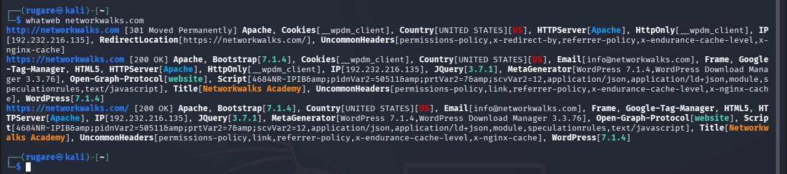
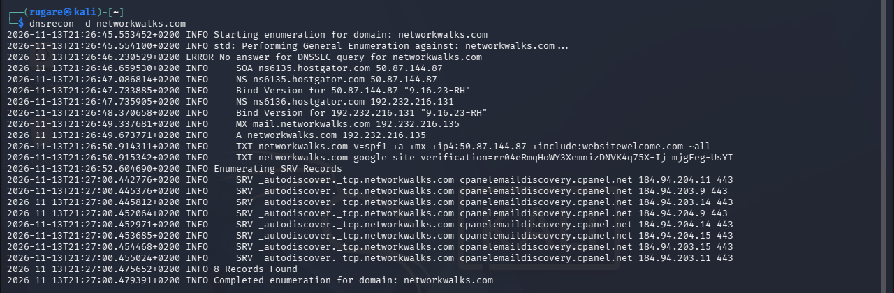
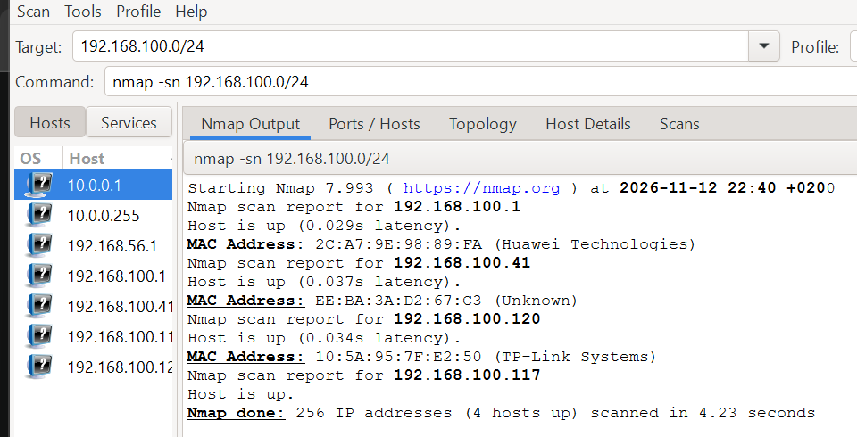
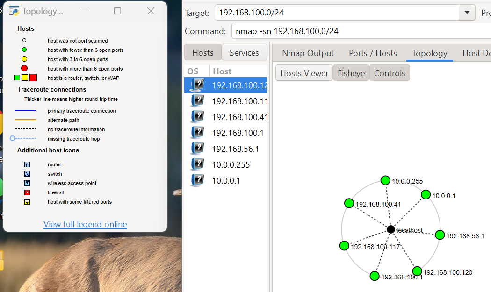

# Week 2: Footprinting & Network Scanning

**Networkwalks Cybersecurity Internship | Batch B084**
**Modules:** W2-PM1 (Multiple Kali Tools) and W2-PM5 (Zenmap Scanning)
**Intern:** Rugare Nyamasvisva

A penetration testing report covering the first two phases of an engagement: reconnaissance
and footprinting of networkwalks.com using six Kali Linux tools, and network discovery of my own
local network using Zenmap.

## Report

- [Report (PDF)](Report/W2-PM-FINAL_Rugare_Nyamasvisva_Report.pdf)
- [Report (Word)](Report/W2-PM-FINAL_Rugare_Nyamasvisva_Report.docx)
- [Network topology (PDF)](Report/Topology.pdf)

## Tools used

| Tool | Purpose |
|------|---------|
| Kali Linux and Windows | Operating systems used for the activities |
| WHOIS | Domain registration details (registrar, dates, name servers) |
| WhatWeb | Fingerprint web technologies (server, CMS, plugins, IP) |
| Nslookup | Resolve the domain name to its IP address |
| Curl (-I) | Read the HTTP response headers |
| Wafw00f | Detect a Web Application Firewall |
| DNSRecon | Enumerate DNS records (NS, MX, SPF, TXT, SRV) |
| Zenmap (Nmap GUI) | Discover live hosts, IP and MAC addresses on the local subnet |

## Key results

- **WHOIS:** registered through GoDaddy.com, LLC on 6 November 2019 and registered until
  6 November 2027. Owner details are hidden by a privacy service, the name servers are HostGator,
  and DNSSEC is unsigned.
- **WhatWeb:** WordPress 7.1.4 and WP Download Manager 3.3.76 on Apache, with jQuery 3.7.1,
  Google Tag Manager and a 301 redirect from HTTP to HTTPS.
- **Nslookup:** networkwalks.com resolves to 192.232.216.135.
- **Curl:** HTTP/2 200 from an Apache server, with caching headers and the WordPress REST API
  endpoint `/wp-json/`. No Strict-Transport-Security, X-Frame-Options, X-Content-Type-Options or
  Content-Security-Policy headers were seen in the response.
- **Wafw00f:** the site is behind ModSecurity (SpiderLabs).
- **DNSRecon:** NS, MX, SPF/TXT and SRV records enumerated, and the BIND version of both name
  servers (9.16.23-RH) was exposed. My first attempt failed because I left out `.com`, a reminder
  that tools need exact syntax.
- **Zenmap:** a ping scan of 192.168.100.0/24 found 4 live hosts in 4.23 seconds.

The report turns these observations into a risk table and recommendations. They are
observations, not confirmed vulnerabilities: no exploitation was performed.

## Screenshots

WhatWeb:



DNSRecon:



Wafw00f:


Zenmap ping scan:



Zenmap topology:



All screenshots are in the [screenshots](screenshots) folder.

## Ethics and scope

I performed these activities only on systems where I had permission or on devices and networks
I own. This material is for education and research. Do not use anything from it to break the law.

## Repository structure

```
.
├── README.md
├── Report/
│   ├── W2-PM-FINAL_Rugare_Nyamasvisva_Report.pdf
│   ├── W2-PM-FINAL_Rugare_Nyamasvisva_Report.docx
│   └── Topology.pdf
└── screenshots/
```

## Author

Rugare Nyamasvisva, Harare, Zimbabwe
Networkwalks Cybersecurity Internship, Batch B084
